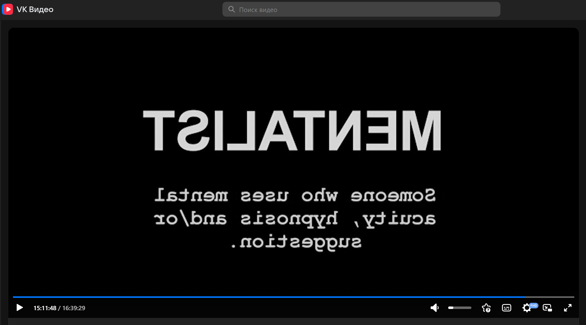
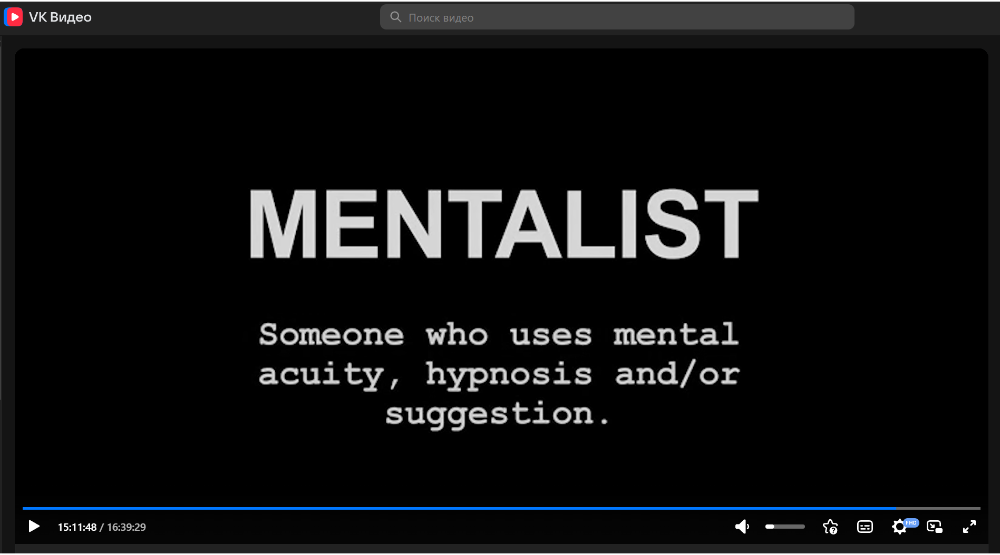

# 🪞 Video Mirror Flip

**Mirror (flip) videos on any website with a single key combination**

[🇷🇺 Русский](README.md) · 🇬🇧 English

---

## ✨ Features

- 🔁 Mirror a video with **Alt + M**; press again to restore the original
- 🌐 Works on any website (`*://*/*`)
- ⌨️ Layout-independent: uses the physical key, so it works with any keyboard layout
- 🧩 Finds videos inside Shadow DOM (for example, on VK)
- 🎬 Picks up videos that load later (next episode, player change)
- 🖥️ The notification is visible in fullscreen mode too
- 🛡️ Does not interfere with typing and ignores key repeat

## 🖼️ Example

| Before | After (Alt + M) |
| --- | --- |
|  |  |

## 🚀 Installation

1. Install the [Tampermonkey](https://tampermonkey.net) extension.
2. Click the **Install** button above and confirm the installation in Tampermonkey.

The script is also available on [Greasy Fork](https://greasyfork.org/en/scripts/599901-video-mirror-flip-websites).

Updates are delivered automatically through Tampermonkey.

## 🎮 Usage

| Action | Result |
| --- | --- |
| **Alt + M** on a page with a video | The video is mirrored |
| **Alt + M** again | The video is back to normal |

If there are several videos on the page, all of them are mirrored at once.

## ⚠️ Known limitations

- **Videos inside an iframe.** The key works only in the frame that currently has focus. If focus is on the parent page, a video inside a frame will not be mirrored. Clicking the video usually helps.
- **Closed Shadow DOM.** Videos inside a `closed` shadow root are not accessible to the script.
- **Canvas and WebGL players.** If the picture is not rendered through the `<video>` tag, it cannot be mirrored.
- **Picture-in-Picture (PiP).** The PiP window is rendered separately by the browser, so the mirroring may not apply there.
- **Notification in fullscreen.** If the `<video>` tag itself is fullscreen, the notification cannot be shown. The effect is still applied.
- **Older browsers.** The script uses the CSS `scale` property (Chrome 104+, Firefox 72+, Safari 14.1+).
- **Not tested on every website.** If it does not work on some site, please open an [issue](https://github.com/aromihsoy/video-mirror-flip/issues) with the page address.

## 🤝 Feedback

Found a bug or have an idea? Open an [issue](https://github.com/aromihsoy/video-mirror-flip/issues).
